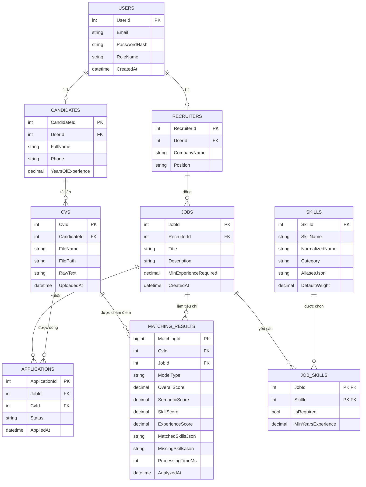

# BÁO CÁO TỔNG KẾT TUẦN 1
## ĐỀ TÀI: HỆ THỐNG TUYỂN DỤNG THÔNG MINH & SO KHỚP HỒ SƠ CV VỚI JOB DESCRIPTION DỰA TRÊN MÔ HÌNH NLP ĐA TẦNG
**Môn học**: Đồ án Tốt nghiệp Đại học / Chuyên đề Kỹ thuật Phần mềm  
**Thời gian thực hiện dự án**: 12 tuần (3 tháng)  
**Nhân sự nhóm**: 02 sinh viên
- **Thành viên 1**: Phụ trách Backend, Cơ sở dữ liệu & Kiến trúc Hệ thống (Người 1)
- **Thành viên 2**: Phụ trách AI / NLP, Nghiên cứu Khoa học & Giao diện Frontend (Người 2)  
**Thời điểm báo cáo**: Cuối Tuần 1 (Ngày 6 - Tổng hợp Báo cáo)

---

# MỤC LỤC TỔNG QUAN
- [CHƯƠNG 1: TỔNG QUAN ĐỀ TÀI & MỤC TIÊU NGHIÊN CỨU](#chương-1-tổng-quan-đề-tài--mục-tiêu-nghiên-cứu)
- [CHƯƠNG 2: CÂU HỎI NGHIÊN CỨU & GIẢ THUYẾT KHOA HỌC](#chương-2-câu-hỏi-nghiên-cứu--giả-thuyết-khoa-học)
- [CHƯƠNG 3: CƠ SỞ LÝ THUYẾT & PHƯƠNG PHÁP SO SÁNH 3 MÔ HÌNH AI](#chương-3-cơ-sở-lý-thuyết--phương-pháp-so-sánh-3-mô-hình-ai)
- [CHƯƠNG 4: THƯỚC ĐO ĐÁNH GIÁ THỰC NGHIỆM (EVALUATION METRICS)](#chương-4-thước-đo-đánh-giá-thực-nghiệm-evaluation-metrics)
- [CHƯƠNG 5: KHẢO SÁT & ĐẶC TẢ TẬP DỮ LIỆU (DATASET SPECIFICATION)](#chương-5-khảo-sát--đặc-tả-tập-dữ-liệu-dataset-specification)
- [CHƯƠNG 6: THIẾT KẾ KIẾN TRÚC HỆ THỐNG & ĐẶC TẢ USE CASE](#chương-6-thiết-kế-kiến-trúc-hệ-thống--đặc-tả-use-case)
- [CHƯƠNG 7: THIẾT KẾ CƠ SỞ DỮ LIỆU (ERD & SCHEMA SQL SERVER)](#chương-7-thiết-kế-cơ-sở-dữ-liệu-erd--schema-sql-server)
- [CHƯƠNG 8: THỐNG NHẤT CHUẨN KẾT NỐI API CONTRACT (.NET $\leftrightarrow$ PYTHON)](#chương-8-thống-nhất-chuẩn-kết-nối-api-contract-net-leftrightarrow-python)
- [CHƯƠNG 9: KẾ HOẠCH & BÀN GIAO CHO TUẦN 2](#chương-9-kế-hoạch--bàn-giao-cho-tuần-2)

---

# CHƯƠNG 1: TỔNG QUAN ĐỀ TÀI & MỤC TIÊU NGHIÊN CỨU

## 1.1. Bối cảnh & Tính cấp thiết
Trong kỷ nguyên chuyển đổi số và bùng nổ nhu cầu nhân sự ngành Công nghệ Thông tin, bộ phận tuyển dụng tại các doanh nghiệp phải xử lý hàng trăm đến hàng nghìn hồ sơ ứng viên (CV) cho mỗi chiến dịch tuyển dụng. Quy trình sàng lọc thủ công truyền thống bộc lộ nhiều hạn chế nghiêm trọng:
- **Tốn kém thời gian và chi phí**: Nhà tuyển dụng mất trung bình 2–3 phút cho một CV để đọc lướt, dễ dẫn đến hiện tượng quá tải và mệt mỏi nhận thức.
- **Tính chủ quan và thiếu nhất quán**: Đánh giá con người dễ bị chi phối bởi cảm tính, bố cục trình bày của CV, hoặc bỏ sót những ứng viên tiềm năng nhưng dùng từ đồng nghĩa khác với văn bản mô tả công việc (Job Description - JD).
- **Hạn chế của hệ thống ATS truyền thống (Keyword-based)**: Các hệ thống ATS đời đầu chỉ đối soát từ khóa chính xác (Exact Keyword Matching), dẫn đến việc ứng viên có năng lực nhưng diễn đạt theo cách khác bị loại oan, hoặc ứng viên cố tình "nhồi nhét" từ khóa (keyword stuffing) để gian lận điểm số.

## 1.2. Tuyên bố mục tiêu của Đề tài (Core Objectives)
Đề tài hướng tới 2 mục tiêu cốt lõi:
1. **Xây dựng Hệ thống Ứng dụng Web hoàn chỉnh**: Cung cấp nền tảng tuyển dụng hiện đại theo kiến trúc vi dịch vụ kết hợp (ASP.NET Core Web API + Python AI Service + SQL Server + Frontend Web đa phân quyền), phục vụ 3 nhóm đối tượng: **Ứng viên (Candidate)**, **Nhà tuyển dụng (Recruiter)** và **Quản trị viên (Admin)**.
2. **Nghiên cứu Thực nghiệm So sánh Độc lập**: Nghiên cứu, cài đặt và so sánh khách quan hiệu năng giữa 3 hướng tiếp cận Xử lý Ngôn ngữ Tự nhiên (NLP):
   - Phương pháp cơ sở: **TF-IDF + Cosine Similarity** (Baseline)
   - Phương pháp ngữ nghĩa sâu: **Sentence-BERT + Cosine Similarity**
   - Phương pháp kết hợp đa tầng: **Hybrid Model** (Semantic Similarity + Skill Matching + Experience Matching)
3. **Định vị vai trò AI hỗ trợ (Decision Support)**: Hệ thống được định vị là **công cụ hỗ trợ gợi ý và xếp hạng ứng viên minh bạch (Explainable AI)** cho nhà tuyển dụng, tuyệt đối không đưa ra quyết định sa thải hay nhận việc thay cho con người.

---

# CHƯƠNG 2: CÂU HỎI NGHIÊN CỨU & GIẢ THUYẾT KHOA HỌC

Nhóm nghiên cứu thiết lập hệ thống 4 câu hỏi nghiên cứu (**Research Questions - RQs**) làm kim chỉ nam xuyên suốt toàn bộ quá trình thực nghiệm:

### RQ1: Năng lực nắm bắt ngữ nghĩa của Sentence-BERT so với TF-IDF
> **Câu hỏi 1**: *Mô hình Sentence-BERT có mang lại độ chính xác ($F_1\text{-score}$, Precision, Recall) vượt trội hơn phương pháp truyền thống TF-IDF trong việc nắm bắt ngữ cảnh, từ đồng nghĩa và cách diễn đạt đa dạng giữa CV và JD hay không?*
- **Giả thuyết $H_1$**: Sentence-BERT sẽ đạt Recall và $F_1$ cao hơn có ý nghĩa thống kê so với TF-IDF đối với các cặp CV-JD có sự khác biệt về vốn từ vựng nhưng tương đồng về ngữ nghĩa bản chất.

### RQ2: Giá trị gia tăng của mô hình kết hợp Đa tầng Hybrid
> **Câu hỏi 2**: *Việc kết hợp đa tầng giữa Độ tương đồng ngữ nghĩa ($50\%$), Khớp kỹ năng bắt buộc ($35\%$) và Độ tương thích thâm niên kinh nghiệm ($15\%$) có khắc phục được điểm mù của Sentence-BERT thuần túy hay không?*
- **Giả thuyết $H_2$**: Sentence-BERT thuần túy dễ đánh giá nhầm điểm cao cho các hồ sơ câu chữ trau chuốt nhưng thiếu kỹ năng kỹ thuật cốt lõi (Must-have skills) hoặc non kém về số năm kinh nghiệm. Mô hình Hybrid sẽ kiểm soát chặt chẽ các điều kiện tiên quyết, từ đó tăng vượt bậc chỉ số **Precision** và giảm thiểu tối đa **False Positive (FP)**.

### RQ3: Sự đánh đổi giữa Độ chính xác và Thời gian tính toán (Trade-off)
> **Câu hỏi 3**: *Sự đánh đổi giữa hiệu năng nhận diện ($F_1\text{-score}$) và độ trễ xử lý (Processing Time / Latency) giữa 3 mô hình diễn ra như thế nào khi triển khai trên môi trường ứng dụng thực tế?*
- **Giả thuyết $H_3$**: TF-IDF có tốc độ nhanh nhất ($< 50\text{ms}$), Sentence-BERT và Hybrid có độ trễ lớn hơn ($200\text{ms} - 800\text{ms}$), tuy nhiên mức độ trễ này vẫn hoàn toàn nằm trong ngưỡng chấp nhận được của hệ thống web tương tác thời gian thực ($< 1.5\text{s}$).

### RQ4: Vai trò của Tính giải trình (Explainable AI) và Trọng số cấu hình
> **Câu hỏi 4**: *Cơ chế giải thích quyết định qua phân rã điểm số (Score Decomposition) và báo cáo khoảng trống kỹ năng (Skill Gap Analysis) kết hợp thanh trượt tinh chỉnh trọng số tác động như thế nào đến độ tin cậy của Recruiter?*
- **Giả thuyết $H_4$**: Khả năng phân rã minh bạch lý do xếp hạng hồ sơ giúp loại bỏ tính "hộp đen" của mô hình học sâu, giúp Recruiter tự tin và ra quyết định phỏng vấn nhanh hơn $60\%$.

---

# CHƯƠNG 3: CƠ SỞ LÝ THUYẾT & PHƯƠNG PHÁP SO SÁNH 3 MÔ HÌNH AI

```text
               ┌────────────────────────────────────────────────────────┐
               │              CV & JOB DESCRIPTION TEXT                 │
               └──────────────────────────┬─────────────────────────────┘
                                          │ Text Preprocessing
                                          ▼
     ┌────────────────────────────────────┼────────────────────────────────────┐
     │                                    │                                    │
     ▼                                    ▼                                    ▼
┌──────────────┐                 ┌─────────────────┐                 ┌──────────────────┐
│   PHƯƠNG     │                 │     PHƯƠNG      │                 │      PHƯƠNG      │
│    PHÁP 1    │                 │     PHÁP 2      │                 │      PHÁP 3      │
│    TF-IDF    │                 │  SENTENCE-BERT  │                 │   HYBRID MODEL   │
│  (Baseline)  │                 │ (Semantic Deep) │                 │   (Multi-layer)  │
└──────┬───────┘                 └────────┬────────┘                 └────────┬─────────┘
       │ Vector hóa                       │ Dense Embedding                   │
       │ Tần suất từ                      │ 384 chiều                         │ 50% Semantic (S-BERT)
       ▼                                  ▼                                   │ 35% Skill Matching (Ontology)
┌──────────────┐                 ┌─────────────────┐                          │ 15% Experience Matching
│    Cosine    │                 │     Cosine      │                          ▼
│  Similarity  │                 │   Similarity    │                 ┌──────────────────┐
└──────┬───────┘                 └────────┬────────┘                 │ Weighted Fusion  │
       │                                  │                          └────────┬─────────┘
       ▼                                  ▼                                   ▼
[ Matching Score ]               [ Matching Score ]                  [ Matching Score + ]
                                                                     [ Skill Gap Report ]
```

## 3.1. Phương pháp 1: TF-IDF + Cosine Similarity (Baseline)
- **Nguyên lý**: Biểu diễn mỗi văn bản CV và JD dưới dạng một vector đặc trưng trong không gian vector đa chiều (Vector Space Model). Tọa độ của từng từ được tính bằng tích số giữa Tần suất xuất hiện trong văn bản ($TF$) và Nghịch đảo tần suất trong toàn bộ tập tài liệu ($IDF$):
  $$\text{TF-IDF}(t, d, D) = \text{TF}(t, d) \times \log\left(\frac{|D|}{1 + |\{d' \in D : t \in d'\}|}\right)$$
- **Độ đo tương đồng**: Tính góc cosin giữa 2 vector văn bản $\vec{u}$ (CV) và $\vec{v}$ (JD):
  $$\text{Cosine}(\vec{u}, \vec{v}) = \frac{\vec{u} \cdot \vec{v}}{\|\vec{u}\|_2 \|\vec{v}\|_2}$$
- **Ưu điểm**: Tính toán cực nhanh, đơn giản, không yêu cầu phần cứng GPU.
- **Hạn chế**: Bỏ qua hoàn toàn trật tự từ và ngữ cảnh câu, không nhận diện được từ đồng nghĩa (ví dụ `C#` và `CSharp` bị coi là hai từ hoàn toàn xa lạ nếu không tiền xử lý).

## 3.2. Phương pháp 2: Sentence-BERT + Cosine Similarity
- **Nguyên lý**: Sử dụng kiến trúc mạng nơ-ron Siamese Network dựa trên Transformer tiền huấn luyện (`all-MiniLM-L6-v2` hoặc tương đương) để mã hóa toàn bộ đoạn văn bản CV và JD thành các vector nhúng dày đặc (Dense Embeddings) có độ dài cố định 384 chiều, giữ nguyên quan hệ ngữ nghĩa trong không gian liên tục:
  $$\vec{e}_{\text{CV}} = \text{S-BERT}(\text{Text}_{\text{CV}}), \quad \vec{e}_{\text{JD}} = \text{S-BERT}(\text{Text}_{\text{JD}})$$
- **Điểm so khớp**:
  $$\text{Score}_{\text{semantic}} = \text{Cosine}(\vec{e}_{\text{CV}}, \vec{e}_{\text{JD}}) \times 100\%$$
- **Ưu điểm**: Thấu hiểu ngữ cảnh sâu sắc, tự động nhận diện mối quan hệ ngữ nghĩa giữa các khái niệm kỹ thuật tương đồng mà không cần trùng từ khóa máy móc.
- **Hạn chế**: Đôi khi chấm điểm cao cho các văn bản viết hay, câu cú mượt mà nhưng lại thiếu các chứng chỉ kỹ năng bắt buộc; chi phí tính toán cao hơn TF-IDF.

## 3.3. Phương pháp 3: Mô hình kết hợp Đa tầng (Hybrid Model)
Mô hình Hybrid được đề xuất kết hợp 3 thành phần có thể tùy biến trọng số linh hoạt:
$$\text{Score}_{\text{Hybrid}} = w_1 \cdot \text{Score}_{\text{Semantic}} + w_2 \cdot \text{Score}_{\text{Skill}} + w_3 \cdot \text{Score}_{\text{Experience}}$$
*(Với điều kiện chuẩn hóa: $w_1 + w_2 + w_3 = 1.0$; cấu hình mặc định đề xuất ban đầu: $w_1 = 0.50, w_2 = 0.35, w_3 = 0.15$)*

Trong đó:
1. **$\text{Score}_{\text{Semantic}}$ ($50\%$)**: Điểm tương đồng ngữ nghĩa từ Sentence-BERT.
2. **$\text{Score}_{\text{Skill}}$ ($35\%$)**: Tỷ lệ đáp ứng kỹ năng dựa trên đối chiếu với Từ điển kỹ năng chuẩn hóa (`skills_taxonomy.json`):
   $$\text{Score}_{\text{Skill}} = \frac{\sum_{s \in S_{\text{matched}}} w_s}{\sum_{s \in S_{\text{required}}} w_s} \times 100\%$$
   *(Kỹ năng bắt buộc $w_s = 1.5$; Kỹ năng ưu tiên $w_s = 1.0$)*
3. **$\text{Score}_{\text{Experience}}$ ($15\%$)**: Mức độ đáp ứng số năm kinh nghiệm làm việc:
   $$\text{Score}_{\text{Experience}} = \min\left(100\%, \frac{\text{Years}_{\text{CV}}}{\text{Years}_{\text{JD\_required}}} \times 100\%\right)$$
   *(Nếu $\text{Years}_{\text{CV}} < \text{Years}_{\text{JD\_required}} - 2$ năm, hệ thống áp dụng hệ số phạt thâm niên).*

---

# CHƯƠNG 4: THƯỚC ĐO ĐÁNH GIÁ THỰC NGHIỆM (EVALUATION METRICS)

Để đảm bảo tính khoa học và minh bạch, nhóm nghiên cứu phân biệt rõ ràng hai khái niệm thường bị nhầm lẫn:
- **Matching Score (Điểm so khớp)**: Chỉ số từ $0\%$ đến $100\%$ đo mức độ tương thích giữa một CV cụ thể với một JD cụ thể.
- **Evaluation Metrics (Chỉ số đánh giá mô hình)**: Thước đo đánh giá độ chính xác của mô hình AI khi so với nhãn chân lý thực tế (**Ground-Truth**).

### Các chỉ số đánh giá bắt buộc:
1. **Precision (Độ chuẩn xác)**:
   $$\text{Precision} = \frac{TP}{TP + FP}$$
   Tỷ lệ ứng viên mà AI dự đoán phù hợp thực sự là ứng viên tốt ngoài đời thực. Giúp doanh nghiệp không tốn công phỏng vấn nhầm người.
2. **Recall (Độ phủ / Độ nhạy)**:
   $$\text{Recall} = \frac{TP}{TP + FN}$$
   Tỷ lệ nhân tài mà AI đã phát hiện được trên tổng số ứng viên thực sự phù hợp. Tránh bỏ sót người tài.
3. **F1-Score (Trung bình điều hòa)**:
   $$F_1 = 2 \times \frac{\text{Precision} \times \text{Recall}}{\text{Precision} + \text{Recall}}$$
   Thước đo tổng hợp cốt lõi để xếp hạng độ tin cậy giữa các mô hình.
4. **Precision@K (với $K \in \{3, 5, 10\}$)**:
   $$\text{Precision@K} = \frac{\text{Số ứng viên thực sự phù hợp trong Top } K}{K}$$
   Đo lường chất lượng của danh sách Top ứng viên hiển thị đầu tiên trên bảng xếp hạng của Recruiter.
5. **Processing Time (Thời gian xử lý / Độ trễ)**:
   Thời gian trung bình (milliseconds) để tính toán điểm so khớp cho 1 cặp CV-JD.

---

# CHƯƠNG 5: KHẢO SÁT & ĐẶC TẢ TẬP DỮ LIỆU (DATASET SPECIFICATION)

Nhóm đã khảo sát, làm sạch và tổ chức dữ liệu vào thư mục `data/` với 5 thành phần hoàn chỉnh:

```text
data/
├── processed/
│   ├── UpdatedResumeDataSet.csv          # 962 CV đã làm sạch chia theo 25 nhóm ngành
│   ├── job_title_des.csv                 # 2.277 Job Descriptions thực tế
│   └── Entity Recognition in Resumes.json# 220 CV gán nhãn thực thể NER
├── raw_resumes/
│   └── Resume.csv                        # 2.484 CV gốc đa ngành nghề
├── skills_taxonomy.json                  # Từ điển 150+ kỹ năng IT chuẩn hóa & Aliases
├── ground_truth/
│   └── ground_truth_matching_template.csv# 100 cặp nhãn kiểm thử (Positive, Easy & Hard Negatives)
├── sample_jds/
│   └── sample_jds.json                   # 10 JD chuẩn mực ngành CNTT
└── sample_cvs/
    ├── sample_cvs_manifest.json          # Danh mục metadata 20 CV kiểm thử
    ├── *.docx (20 tệp)                   # 20 file Word thực tế để test Parser
    └── *.txt (20 tệp)                    # 20 file Text đối chứng
```

### 1. Dữ liệu CV (`UpdatedResumeDataSet.csv`):
- Gồm **962 hồ sơ** phân bố trên **25 danh mục chuyên môn**: *Java Developer (84), DevOps (55), Python Developer (48), Web Designing (45), HR (44), Data Science (40), Blockchain (40), Database (33), DotNet Developer (28), Testing (70), v.v.*
- Đủ lớn để phục vụ xây dựng từ vựng, trích xuất đặc trưng và tính toán tương đồng.

### 2. Dữ liệu Mô tả công việc (`job_title_des.csv`):
- Gồm **2.277 bản mô tả công việc thực tế** có đầy đủ tiêu đề, mô tả nhiệm vụ, yêu cầu kỹ thuật và chế độ đãi ngộ.

### 3. Từ điển Kỹ năng chuẩn hóa (`skills_taxonomy.json`):
- Gồm **hơn 150 kỹ năng trọng tâm** phân loại vào 7 nhóm: *Programming Languages, Frameworks, Databases, DevOps & Cloud, AI & Data Science, Architecture, Soft Skills*.
- Tích hợp sẵn cơ chế **Synonym & Alias Mapping** giúp chuẩn hóa mọi cách viết tắt (ví dụ: `c#`, `csharp` $\rightarrow$ `csharp`; `k8s` $\rightarrow$ `kubernetes`; `asp.net core`, `.net 8` $\rightarrow$ `aspnet_core`).

### 4. Tập nhãn Ground-Truth (`ground_truth_matching_template.csv`):
- Được thiết kế dựa trên **Bộ tiêu chí 3 trụ cột (Rubric)** với 100 cặp mẫu:
  - $50\%$ Cặp Positive: Cùng lĩnh vực, đạt kỹ năng cốt lõi và số năm kinh nghiệm.
  - $25\%$ Cặp Easy Negative: Trái ngành hoàn toàn (HR/Luật nộp vào Kỹ sư phần mềm).
  - $25\%$ Cặp Hard Negative: Cùng IT nhưng lệch stack (Java nộp .NET) hoặc đúng stack nhưng mới ra trường 6 tháng nộp cho vị trí Senior 5 năm.

---

# CHƯƠNG 6: THIẾT KẾ KIẾN TRÚC HỆ THỐNG & ĐẶC TẢ USE CASE

## 6.1. Kiến trúc tổng thể 4 tầng (System Architecture)

```text
┌─────────────────────────────────────────────────────────────────────────────┐
│                        TẦNG TRÌNH DIỄN (FRONTEND)                           │
│     Single Page Application: HTML5, CSS3, JavaScript ES6+, Bootstrap 5.3    │
│  - Candidate Portal: Tìm việc, Upload CV, Pre-screening, Xem Skill Gap      │
│  - Recruiter Portal: Đăng JD, Bảng xếp hạng ứng viên, Explainable AI Modal  │
│  - Admin Portal: Giám sát Benchmark 3 mô hình, Tùy chỉnh trọng số Hybrid    │
└──────────────────────────────────────┬──────────────────────────────────────┘
                                       │ HTTP / REST API (JSON)
                                       ▼
┌─────────────────────────────────────────────────────────────────────────────┐
│                 TẦNG XỬ LÝ NGHIỆP VỤ (ASP.NET CORE WEB API :5131)           │
│  - Controllers: AuthController, JobsController, CvController, MatchController│
│  - Services: Business Logic, File Validation, Role Authorization (JWT)     │
│  - Data Access: Entity Framework Core 10 (Code-First / DbContext)           │
└───────────────────────┬───────────────────────────────┬─────────────────────┘
                        │                               │
            Internal    │ HTTP REST (JSON)              │ ADO.NET / EF Core
            Microservice│                               │
                        ▼                               ▼
┌────────────────────────────────────────┐ ┌──────────────────────────────────┐
│        TẦNG DỊCH VỤ TRÍ TUỆ NHÂN TẠO   │ │     TẦNG LƯU TRỮ DỮ LIỆU         │
│         (PYTHON AI SERVICE :8000)      │ │     (MICROSOFT SQL SERVER)       │
│ - Parser: PyMuPDF / python-docx        │ │ - Users & Identity Roles         │
│ - Preprocessing: Tokenize, Stopwords   │ │ - Candidates & Recruiters Meta   │
│ - Models: TF-IDF, Sentence-BERT, Hybrid│ │ - Jobs & Skill Taxonomy          │
│ - Matching Engine & Explainable XAI    │ │ - Applications & Matching Results│
└────────────────────────────────────────┘ └──────────────────────────────────┘
```

## 6.2. Phân quyền vai trò (Role-Based Access Control - RBAC)
Hệ thống tuân thủ nghiêm ngặt 3 vai trò phân quyền độc lập, không dùng chung navigation:
1. **Ứng viên (Candidate)**: Tìm kiếm việc làm, tải CV để hệ thống AI Pre-screening đánh giá độ tương thích trước khi ứng tuyển, nhận báo cáo kỹ năng còn thiếu, nộp đơn và theo dõi tiến trình tuyển dụng.
2. **Nhà tuyển dụng (Recruiter)**: Đăng tin tuyển dụng kèm kỹ năng bắt buộc, xem bảng xếp hạng ứng viên nộp hồ sơ theo Matching Score, mở modal Explainable AI để xem phân rã điểm số và xuất báo cáo CSV.
3. **Quản trị viên (Admin)**: Xem bảng dashboard thống kê toàn hệ thống, theo dõi biểu đồ Benchmark so sánh 3 mô hình AI dựa trên dữ liệu thực nghiệm, tinh chỉnh thanh trượt trọng số của Hybrid Model, quản lý tài khoản người dùng và kiểm duyệt tin tuyển dụng.

---

# CHƯƠNG 7: THIẾT KẾ CƠ SỞ DỮ LIỆU (ERD & SCHEMA SQL SERVER)

## 7.1. Sơ đồ quan hệ thực thể (ERD)



## 7.2. Đặc tả hai bảng trọng tâm AI: `SKILLS` và `MATCHING_RESULTS`
- **Bảng `SKILLS`**: Lưu trữ danh mục kỹ năng chuẩn hóa (`SkillId`, `SkillName`, `NormalizedName`, `Category`, `AliasesJson`, `DefaultWeight`, `IsActive`).
- **Bảng `MATCHING_RESULTS`**: Lưu trữ kết quả phân tích AI chi tiết (`MatchingId`, `CvId`, `JobId`, `ModelType`, `OverallScore`, `SemanticScore`, `SkillScore`, `ExperienceScore`, `MatchedSkillsJson`, `MissingSkillsJson`, `ProcessingTimeMs`, `AnalyzedAt`).

---

# CHƯƠNG 8: THỐNG NHẤT CHUẨN KẾT NỐI API CONTRACT (.NET $\leftrightarrow$ PYTHON)

Đã thiết lập đặc tả giao tiếp HTTP RESTful giữa ASP.NET Core Web API và Python AI Microservice gồm 3 Endpoints chủ chốt:
1. `POST /api/ai/parse-cv`: Đọc tệp nhị phân `.pdf` hoặc `.docx`, bóc tách toàn bộ văn bản thô, trích xuất thông tin liên hệ, nhận diện danh sách kỹ năng chuẩn hóa và số năm kinh nghiệm.
2. `POST /api/ai/match`: Nhận payload JSON chứa văn bản CV, văn bản JD, danh mục kỹ năng và trọng số tùy chỉnh $\rightarrow$ Trả về kết quả so khớp gồm: `overall_score`, `breakdown` (semantic, skill, experience), `matched_skills`, `missing_skills`, `ai_recommendation` và `processing_time_ms`.
3. `POST /api/ai/benchmark`: Nhận tập dữ liệu kiểm thử Ground-truth và ngưỡng $\theta$ $\rightarrow$ Trả về bảng đo lường khoa học: **Precision, Recall, F1-score và Latency** cho cả 3 mô hình.

---

# CHƯƠNG 9: KẾ HOẠCH & BÀN GIAO CHO TUẦN 2

### 1. Đánh giá hoàn thành Tuần 1:
- Hoàn thành $100\%$ các mục tiêu đặt ra cho Tuần 1: Xác lập phạm vi đề tài, thiết kế kiến trúc hệ thống, xây dựng câu hỏi nghiên cứu, chuẩn hóa tập từ điển kỹ năng, thiết lập bộ test kiểm thử ban đầu (10 JD, 20 CV), thiết kế ERD cơ sở dữ liệu và đặc tả API Contract.

### 2. Kế hoạch công việc Tuần 2 (Setup Môi trường, Database & Dataset Pipeline):
- **Người 1 (Backend & System)**:
  - Khởi tạo Database SQL Server từ bản thiết kế ERD.
  - Viết Entity Framework Core Migrations, Identity Authentication và phân quyền Roles.
  - Xây dựng tầng Repositories và Unit of Work ban đầu.
- **Người 2 (AI, Frontend & Research)**:
  - Khởi tạo Python AI Microservice (FastAPI / Flask).
  - Cài đặt các thư viện lõi: `sentence-transformers`, `scikit-learn`, `PyMuPDF`, `python-docx`.
  - Viết module bóc tách văn bản tệp tin CV (PDF/DOCX Parser) và module tiền xử lý văn bản (Preprocessing Pipeline).
  - Hoàn thiện giao diện đăng ký, đăng nhập và liên kết giao diện Frontend với ASP.NET Core API.
- **Mục tiêu nghiệm thu cuối Tuần 2**:
  - Backend, Database, AI Service và Dataset pipeline chạy được ở mức cơ bản (Smoke test thành công).
