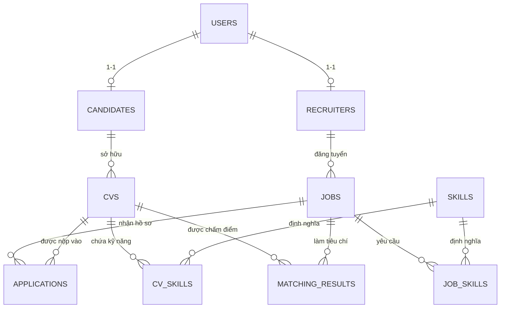

# BÁO CÁO KẾ HOẠCH TUẦN 1 — NGÀY 3
**Phân công thực hiện**: Người 2 (AI, Frontend & Research)  
**Đề tài**: Hệ thống Tuyển dụng Thông minh & So khớp Hồ sơ CV với Job Description (AI Recruitment & Resume Matching System)  
**Ngày thực hiện**: Ngày 3 / Tuần 1  

---

## MỤC TIÊU CÔNG VIỆC NGÀY 3 (NGƯỜI 2)
1. **Nhiệm vụ nghiên cứu chính**:
   - Xây dựng hệ thống các câu hỏi nghiên cứu khoa học (**Research Questions - RQs**) và giả thuyết kiểm định.
   - Xác định và chuẩn hóa danh mục từ khóa kỹ năng (**Skill Taxonomy & Ontology**) cùng cơ chế xử lý từ đồng nghĩa (Synonyms/Aliases).
2. **Giao điểm phối hợp với Người 1 (Backend & System)**:
   - Thống nhất chi tiết cấu trúc bảng cơ sở dữ liệu `MATCHING_RESULTS` và `SKILLS`.
   - Cung cấp sơ đồ quan hệ thực thể (**ERD**) và mã kịch bản SQL Server DDL / Entity Framework Core Model để Người 1 tiến hành thiết kế Database.

---

# PHẦN 1: HỆ THỐNG CÂU HỎI NGHIÊN CỨU (RESEARCH QUESTIONS - RQs)

Theo mục tiêu cốt lõi của đồ án và quy định tại `AGENTS.md`, đề tài tập trung so sánh thực nghiệm 3 phương pháp NLP:
1. **TF-IDF + Cosine Similarity** (Baseline)
2. **Sentence-BERT + Cosine Similarity** (Semantic Embedding)
3. **Hybrid Model** (Semantic + Skill Matching + Experience Matching)

Hệ thống 4 câu hỏi nghiên cứu được xác định cụ thể như sau:

---

### Câu hỏi 1 (RQ1 — Năng lực biểu diễn ngữ nghĩa của Sentence-BERT so với TF-IDF):
> **RQ1**: *Mô hình Sentence-BERT có mang lại độ chính xác ($F_1\text{-score}$, Precision, Recall) vượt trội hơn phương pháp truyền thống TF-IDF trong việc nắm bắt ngữ nghĩa và các trường hợp diễn đạt đa dạng giữa CV và Job Description hay không?*

- **Giả thuyết khoa học ($H_1$)**: Sentence-BERT sẽ đạt Recall và $F_1\text{-score}$ cao hơn đáng kể so với TF-IDF trên các cặp kiểm thử ngữ nghĩa phức tạp (Hard Negatives và Synonyms), nhờ khả năng mã hóa ngữ cảnh sâu thay vì chỉ đếm tần suất từ khóa rời rạc.
- **Phương pháp kiểm chứng**: Chạy đồng thời TF-IDF và một mô hình Sentence-BERT phù hợp ngôn ngữ dữ liệu trên tập ground-truth đã được dán nhãn. Kích thước tập, mô hình cuối cùng và các tham số phải được chốt trước khi thực nghiệm; so sánh bằng ma trận nhầm lẫn, Precision, Recall và $F_1\text{-score}$.

---

### Câu hỏi 2 (RQ2 — Hiệu quả của mô hình kết hợp Đa tầng Hybrid):
> **RQ2**: *Việc kết hợp đa tầng giữa Độ tương đồng ngữ nghĩa (Semantic), Khớp kỹ năng bắt buộc (Skill Matching) và Độ tương thích thâm niên (Experience Matching) trong mô hình Hybrid có khắc phục được các điểm mù của Sentence-BERT thuần túy hay không?*

- **Giả thuyết khoa học ($H_2$)**: Sentence-BERT thuần túy dễ đánh giá nhầm điểm cao cho các hồ sơ có câu từ hoa mỹ nhưng thiếu kỹ năng kỹ thuật cốt lõi (Must-have skills) hoặc non kém về số năm kinh nghiệm. Mô hình Hybrid sẽ cải thiện **Precision** và giảm thiểu tối đa **False Positive (FP)**.
- **Phương pháp kiểm chứng**: So sánh Precision@5 và Precision@10 của mô hình Hybrid so với Sentence-BERT độc lập.

---

### Câu hỏi 3 (RQ3 — Đánh đổi giữa Độ chính xác và Thời gian tính toán):
> **RQ3**: *Sự đánh đổi (Trade-off) giữa độ chính xác dự đoán ($F_1\text{-score}$) và thời gian đáp ứng (Processing Time / Latency) giữa TF-IDF, Sentence-BERT và Hybrid Model diễn ra như thế nào trong môi trường ứng dụng thực tế?*

- **Giả thuyết khoa học ($H_3$)**: Ba phương pháp có thể có đánh đổi giữa chất lượng dự đoán và thời gian xử lý; thứ hạng về latency chưa được kết luận trước khi chạy thí nghiệm trên cùng cấu hình.
- **Phương pháp kiểm chứng**: Ghi nhận thời gian xử lý trên cùng tập cặp CV-JD, cùng máy và cùng quy trình tiền xử lý; báo cáo số lượt chạy, trung bình, trung vị và độ lệch chuẩn cho từng phương pháp.

---

### Câu hỏi 4 (RQ4 — Tính giải trình và Tác động của Trọng số cấu hình):
> **RQ4**: *Cơ chế giải thích quyết định (Explainable AI - XAI) thông qua phân rã điểm số và tính năng tinh chỉnh trọng số linh hoạt (Configurable Weights) giúp ích như thế nào cho Recruiter trong quá trình ra quyết định tuyển dụng?*

- **Giả thuyết khoa học ($H_4$)**: Việc hiển thị điểm thành phần, kỹ năng khớp/thiếu và cho phép cấu hình trọng số có thể giúp recruiter hiểu kết quả hơn. Bộ trọng số ban đầu chỉ là giả định cấu hình, phải được ghi nhận và đánh giá trong thực nghiệm; không phải kết luận nghiên cứu.
- **Phương pháp kiểm chứng**: Khảo sát tính khả dụng (Usability Evaluation) và khả năng tùy biến trọng số theo từng nhóm ngành cụ thể trên Cổng Doanh nghiệp.

---

# PHẦN 2: DANH MỤC TỪ KHÓA KỸ NĂNG CHUẨN HÓA (SKILL TAXONOMY & ONTOLOGY)

Để phục vụ thành phần Skill Matching trong mô hình Hybrid và tính năng Skill Gap Analysis, một danh mục kỹ năng chuẩn hóa đã được khởi tạo và lưu trữ tại `data/skills_taxonomy.json`. Trọng số Hybrid sẽ được cấu hình và đánh giá ở giai đoạn thực nghiệm.

### 1. Phân loại 7 nhóm kỹ năng trọng tâm ngành CNTT
1. **Programming Languages (Ngôn ngữ lập trình)**: C#, Java, Python, JavaScript, TypeScript, PHP, C++, Golang, Rust, Kotlin, Swift, Dart.
2. **Frameworks & Libraries (Khung phát triển & Thư viện)**: ASP.NET Core, Entity Framework Core, Spring Boot, React, Angular, Vue.js, Node.js, Django, Flask, FastAPI, Flutter, Bootstrap, Tailwind CSS, Laravel.
3. **Databases & Storage (Cơ sở dữ liệu & Lưu trữ)**: SQL Server, PostgreSQL, MySQL, MongoDB, Redis, Elasticsearch, Oracle Database.
4. **DevOps, Cloud & Infrastructure (Hạ tầng & Đám mây)**: Docker, Kubernetes, AWS, Microsoft Azure, CI/CD (Jenkins, GitHub Actions), Linux, Git.
5. **AI, Machine Learning & Data Science**: Machine Learning, Deep Learning, Natural Language Processing (NLP), PyTorch, TensorFlow, Scikit-Learn, Pandas & NumPy, Sentence-BERT, TF-IDF.
6. **Architecture & Software Engineering**: RESTful API, Microservices, Object-Oriented Programming (OOP/SOLID), Message Queue (Kafka, RabbitMQ), GraphQL, Unit Testing (xUnit, NUnit).
7. **Soft Skills & Methodologies**: Teamwork, Problem Solving, Communication, Agile / Scrum, English.

---

### 2. Bảng quy tắc chuẩn hóa từ đồng nghĩa (Synonym & Alias Mapping)
Một trong những thách thức lớn nhất khi so khớp CV là ứng viên và nhà tuyển dụng dùng các cách viết khác nhau cho cùng một kỹ năng. Hệ thống sử dụng bảng tra cứu từ đồng nghĩa (Alias Mapping Dictionary):

| Kỹ năng chuẩn (Normalized Canonical Name) | Các biến thể viết tắt / Từ đồng nghĩa trong CV & JD (Aliases) | Nhóm danh mục |
| :--- | :--- | :--- |
| **`csharp` (C#)** | `c#`, `c-sharp`, `c sharp`, `csharp` | Programming Languages |
| **`aspnet_core` (ASP.NET Core)** | `asp.net`, `asp.net core`, `.net core`, `dotnet core`, `.net 6`, `.net 8`, `.net 10`, `web api` | Frameworks |
| **`ef_core` (Entity Framework)** | `ef core`, `entity framework`, `entity framework core`, `linq`, `ef6` | Frameworks |
| **`java` (Java)** | `java`, `core java`, `java 8`, `java 11`, `java 17`, `java 21` | Programming Languages |
| **`spring_boot` (Spring Boot)** | `spring boot`, `spring framework`, `spring mvc`, `spring cloud`, `spring security` | Frameworks |
| **`javascript` (JavaScript)** | `javascript`, `js`, `ecmascript`, `es6`, `es6+` | Programming Languages |
| **`react` (React)** | `react`, `react.js`, `reactjs`, `react native` | Frameworks |
| **`sql_server` (SQL Server)** | `sql server`, `ms sql`, `mssql`, `microsoft sql server`, `t-sql` | Databases |
| **`kubernetes` (Kubernetes)** | `kubernetes`, `k8s` | DevOps & Cloud |
| **`docker` (Docker)** | `docker`, `containerization`, `docker-compose` | DevOps & Cloud |
| **`cicd` (CI/CD)** | `ci/cd`, `ci-cd`, `continuous integration`, `jenkins`, `github actions` | DevOps & Cloud |
| **`nlp` (NLP)** | `nlp`, `natural language processing`, `xử lý ngôn ngữ tự nhiên`, `text mining` | AI / Data Science |

---

### 3. Thuật toán trích xuất và tính điểm Skill Matching
Khi bóc tách văn bản từ CV và JD:
1. **Text Normalization**: Chuyển toàn bộ văn bản về chữ thường (lowercase), loại bỏ ký tự đặc biệt không thuộc cú pháp tên công nghệ (giữ lại `#`, `+`, `.`).
2. **N-gram Matching**: Quét các cụm từ có độ dài từ 1 đến 3 từ đối chiếu với trường `aliases` trong từ điển kỹ năng.
3. **Canonical Mapping**: Ánh xạ mọi biến thể về mã định danh chuẩn `normalized_id`.
4. **Đo độ tương thích Kỹ năng (Weighted Overlap Score)**:
   $$\text{Skill Score} = \frac{\sum_{s \in S_{\text{matched}}} w_s}{\sum_{s \in S_{\text{JD\_required}}} w_s} \times 100\%$$
   *(Trong đó: $w_s = 1.5$ nếu là kỹ năng cốt lõi bắt buộc `IsRequired = true`; $w_s = 1.0$ nếu là kỹ năng ưu tiên cộng điểm `Nice-to-have`).*

---

# PHẦN 3: GIAO ĐIỂM PHỐI HỢP — THỐNG NHẤT CẤU TRÚC BẢNG `SKILLS` VÀ `MATCHING_RESULTS`

Để chuẩn bị cho Người 1 thiết kế sơ đồ ERD và lập trình tầng Database (SQL Server & EF Core), cấu trúc hai bảng trọng tâm đã được thống nhất cụ thể như sau:

## 1. Sơ đồ thực thể liên kết (ERD Diagram)



---

## 2. Đặc tả cấu trúc Bảng `SKILLS`
Bảng lưu trữ từ điển kỹ năng dùng chung cho toàn bộ hệ thống (dùng khi Recruiter tạo JD, Candidate tạo hồ sơ, và AI tính điểm).

| Tên cột | Kiểu dữ liệu (SQL Server) | Khóa / Ràng buộc | Mô tả ý nghĩa |
| :--- | :--- | :---: | :--- |
| `SkillId` | `INT` | **PK, Identity(1,1)** | Mã định danh kỹ năng duy nhất |
| `SkillName` | `NVARCHAR(100)` | **NOT NULL** | Tên hiển thị chuẩn (VD: "ASP.NET Core", "C#") |
| `NormalizedName` | `VARCHAR(100)` | **NOT NULL, UNIQUE** | Tên định danh chuẩn hóa không dấu (VD: "aspnet_core", "csharp") |
| `Category` | `NVARCHAR(50)` | **NOT NULL** | Nhóm danh mục (Programming Languages, Databases, DevOps,...) |
| `AliasesJson` | `NVARCHAR(MAX)` | **NULL** | Mảng JSON chứa các từ đồng nghĩa/viết tắt để AI bóc tách |
| `DefaultWeight` | `DECIMAL(3,2)` | **DEFAULT 1.0** | Trọng số ưu tiên mặc định (từ 0.5 đến 2.0) |
| `IsActive` | `BIT` | **DEFAULT 1** | Trạng thái kích hoạt trong hệ thống |
| `CreatedAt` | `DATETIME2` | **DEFAULT GETUTCDATE()** | Thời điểm tạo bản ghi |

---

## 3. Đặc tả cấu trúc Bảng trung gian `JOB_SKILLS`
Liên kết N-N giữa Công việc (`JOBS`) và Kỹ năng (`SKILLS`).

| Tên cột | Kiểu dữ liệu | Khóa / Ràng buộc | Mô tả ý nghĩa |
| :--- | :--- | :---: | :--- |
| `JobId` | `INT` | **PK, FK -> JOBS(JobId)** | Mã công việc tuyển dụng |
| `SkillId` | `INT` | **PK, FK -> SKILLS(SkillId)** | Mã kỹ năng yêu cầu |
| `IsRequired` | `BIT` | **NOT NULL, DEFAULT 1** | `1`: Kỹ năng bắt buộc (Must-have); `0`: Ưu tiên (Nice-to-have) |
| `MinYearsExperience` | `DECIMAL(3,1)` | **DEFAULT 0.0** | Số năm kinh nghiệm tối thiểu yêu cầu cho kỹ năng này |

---

## 4. Đặc tả cấu trúc Bảng `MATCHING_RESULTS`
Bảng lưu trữ kết quả phân tích AI giữa một CV và một Job Description, phục vụ tính năng hiển thị Dashboard Recruiter, Explainable AI Modal và đối soát nghiên cứu khoa học.

| Tên cột | Kiểu dữ liệu (SQL Server) | Khóa / Ràng buộc | Mô tả ý nghĩa |
| :--- | :--- | :---: | :--- |
| `MatchingId` | `BIGINT` | **PK, Identity(1,1)** | Mã kết quả so khớp duy nhất |
| `CvId` | `INT` | **FK -> CVS(CvId), NOT NULL** | Mã CV được phân tích |
| `JobId` | `INT` | **FK -> JOBS(JobId), NOT NULL** | Mã Job Description làm đối chứng |
| `ModelType` | `VARCHAR(30)` | **NOT NULL** | Tên mô hình sử dụng (`TF-IDF`, `Sentence-BERT`, `Hybrid`) |
| `OverallScore` | `DECIMAL(5,2)` | **NOT NULL** | Điểm tổng hợp cuối cùng ($0.00 \rightarrow 100.00$) |
| `SemanticScore` | `DECIMAL(5,2)` | **NULL** | Điểm tương đồng ngữ nghĩa ($0.00 \rightarrow 100.00$) |
| `SkillScore` | `DECIMAL(5,2)` | **NULL** | Điểm trùng khớp kỹ năng ($0.00 \rightarrow 100.00$) |
| `ExperienceScore` | `DECIMAL(5,2)` | **NULL** | Điểm đánh giá kinh nghiệm ($0.00 \rightarrow 100.00$) |
| `MatchedSkillsJson` | `NVARCHAR(MAX)` | **NULL** | Mảng JSON các kỹ năng trùng khớp |
| `MissingSkillsJson` | `NVARCHAR(MAX)` | **NULL** | Mảng JSON các kỹ năng cốt lõi còn thiếu |
| `BonusSkillsJson` | `NVARCHAR(MAX)` | **NULL** | Mảng JSON các kỹ năng vượt chuẩn (cộng điểm) |
| `ExperienceYearsFound`| `DECIMAL(3,1)` | **NULL** | Số năm kinh nghiệm bóc tách được từ CV |
| `AiExplanation` | `NVARCHAR(MAX)` | **NULL** | Đoạn văn bản tóm tắt giải trình khuyến nghị của AI |
| `ProcessingTimeMs` | `INT` | **NOT NULL** | Thời gian tính toán của mô hình AI (milliseconds) |
| `AnalyzedAt` | `DATETIME2` | **DEFAULT GETUTCDATE()** | Thời điểm chạy phân tích |

---

## 5. Script DDL mẫu gửi Người 1 để chạy trên SQL Server

```sql
-- 1. BẢNG DANH MỤC KỸ NĂNG CHUẨN HÓA
CREATE TABLE SKILLS (
    SkillId INT IDENTITY(1,1) PRIMARY KEY,
    SkillName NVARCHAR(100) NOT NULL,
    NormalizedName VARCHAR(100) NOT NULL UNIQUE,
    Category NVARCHAR(50) NOT NULL,
    AliasesJson NVARCHAR(MAX) NULL,
    DefaultWeight DECIMAL(3,2) NOT NULL DEFAULT 1.0,
    IsActive BIT NOT NULL DEFAULT 1,
    CreatedAt DATETIME2 NOT NULL DEFAULT GETUTCDATE()
);
CREATE INDEX IX_SKILLS_NormalizedName ON SKILLS(NormalizedName);
CREATE INDEX IX_SKILLS_Category ON SKILLS(Category);

-- 2. BẢNG LIÊN KẾT KỸ NĂNG YÊU CẦU THEO CÔNG VIỆC
CREATE TABLE JOB_SKILLS (
    JobId INT NOT NULL,
    SkillId INT NOT NULL,
    IsRequired BIT NOT NULL DEFAULT 1,
    MinYearsExperience DECIMAL(3,1) NOT NULL DEFAULT 0.0,
    CONSTRAINT PK_JOB_SKILLS PRIMARY KEY (JobId, SkillId),
    CONSTRAINT FK_JOB_SKILLS_JOBS FOREIGN KEY (JobId) REFERENCES JOBS(JobId) ON DELETE CASCADE,
    CONSTRAINT FK_JOB_SKILLS_SKILLS FOREIGN KEY (SkillId) REFERENCES SKILLS(SkillId) ON DELETE CASCADE
);

-- 3. BẢNG KẾT QUẢ SO KHỚP AI
CREATE TABLE MATCHING_RESULTS (
    MatchingId BIGINT IDENTITY(1,1) PRIMARY KEY,
    CvId INT NOT NULL,
    JobId INT NOT NULL,
    ModelType VARCHAR(30) NOT NULL, -- 'TF-IDF', 'Sentence-BERT', 'Hybrid'
    OverallScore DECIMAL(5,2) NOT NULL,
    SemanticScore DECIMAL(5,2) NULL,
    SkillScore DECIMAL(5,2) NULL,
    ExperienceScore DECIMAL(5,2) NULL,
    MatchedSkillsJson NVARCHAR(MAX) NULL,
    MissingSkillsJson NVARCHAR(MAX) NULL,
    BonusSkillsJson NVARCHAR(MAX) NULL,
    ExperienceYearsFound DECIMAL(3,1) NULL,
    AiExplanation NVARCHAR(MAX) NULL,
    ProcessingTimeMs INT NOT NULL,
    AnalyzedAt DATETIME2 NOT NULL DEFAULT GETUTCDATE()
);
CREATE INDEX IX_MATCHING_RESULTS_CvId_JobId ON MATCHING_RESULTS(CvId, JobId);
CREATE INDEX IX_MATCHING_RESULTS_OverallScore ON MATCHING_RESULTS(OverallScore DESC);
```

---

## KẾT LUẬN & BÀN GIAO CHO NGÀY 4
- **Hoàn thành trọn vẹn Ngày 3**:
  1. Đã xây dựng 4 câu hỏi nghiên cứu (RQs) và giả thuyết khoa học sắc bén, đúng quy chuẩn nghiên cứu.
  2. Đã khởi tạo taxonomy kỹ năng ngành IT gồm 7 nhóm và biến thể từ đồng nghĩa tại `data/skills_taxonomy.json`.
  3. Đã thống nhất cấu trúc bảng `SKILLS`, `JOB_SKILLS` và `MATCHING_RESULTS` kèm sơ đồ ERD và mã SQL DDL gửi Người 1.
- **Kế hoạch Ngày 4**:
  - Người 2: Chuẩn bị 20–30 CV giả lập/đã ẩn danh và 10 JD mẫu có nguồn gốc ghi nhận rõ ràng cho bộ test ban đầu.
  - Phối hợp Người 1: Thống nhất chuẩn dữ liệu API Contract (JSON Request / Response body) giữa ASP.NET Core Backend và Python AI Service.
