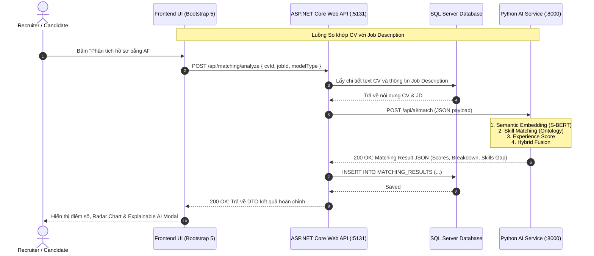

# BÁO CÁO KẾ HOẠCH TUẦN 1 — NGÀY 4
**Phân công thực hiện**: Người 2 (AI, Frontend & Research)  
**Đề tài**: Hệ thống Tuyển dụng Thông minh & So khớp Hồ sơ CV với Job Description (AI Recruitment & Resume Matching System)  
**Ngày thực hiện**: Ngày 4 / Tuần 1  

---

## MỤC TIÊU CÔNG VIỆC NGÀY 4 (NGƯỜI 2)
1. **Nhiệm vụ chính**:
   - Khởi tạo bộ dữ liệu kiểm thử nội bộ (Initial Test Suite) gồm **10 Job Descriptions (JD)** và **20 CV giả lập/đã ẩn danh** ở định dạng `.docx` và văn bản, phục vụ kiểm thử parser và thuật toán matching.
2. **Giao điểm phối hợp với Người 1 (Backend & System)**:
   - Thống nhất chuẩn dữ liệu trao đổi giữa **ASP.NET Core Web API** và **Python AI Microservice** (**API Contract**).
   - Định nghĩa chi tiết cấu trúc JSON Request / Response, mã trạng thái HTTP, cơ chế timeout và xử lý lỗi đồng bộ.

---

# PHẦN 1: BỘ DỮ LIỆU KIỂM THỬ BAN ĐẦU (INITIAL TEST SUITE)

Bộ dữ liệu kiểm thử đã được tổ chức thành cấu trúc rõ ràng trong thư mục `data/`:

```text
data/
├── sample_jds/
│   └── sample_jds.json                 # 10 JD mẫu chuẩn hóa đầy đủ tiêu chí
└── sample_cvs/
    ├── sample_cvs_manifest.json        # Danh mục metadata 20 CV mẫu
    ├── *.docx (20 tệp)                 # 20 file Word hợp lệ để test parser
    └── *.txt (20 tệp)                  # 20 file Text thô đối chứng
```

### 1. Danh sách 10 Job Descriptions mẫu (`data/sample_jds/sample_jds.json`)

| Mã JD | Vị trí công việc (Job Title) | Cấp bậc | Kinh nghiệm | Kỹ năng bắt buộc (Must-have) |
| :--- | :--- | :---: | :---: | :--- |
| **JOB_001** | Senior Backend .NET Engineer | Senior | $\ge 4.5$ năm | C#, ASP.NET Core, Entity Framework Core, SQL Server, RESTful API |
| **JOB_002** | Java Spring Boot Specialist | Mid-level | $\ge 3.0$ năm | Java, Spring Boot, Hibernate, PostgreSQL, RESTful API |
| **JOB_003** | Frontend React / TypeScript Developer | Mid-level | $\ge 2.5$ năm | JavaScript, TypeScript, React, HTML5, CSS3, Tailwind CSS |
| **JOB_004** | Fullstack Node.js & Vue.js Developer | Mid-level | $\ge 3.0$ năm | JavaScript, TypeScript, Node.js, Vue.js, MySQL, MongoDB |
| **JOB_005** | AI & Machine Learning Engineer | Senior | $\ge 4.0$ năm | Python, Machine Learning, Deep Learning, NLP, PyTorch, Scikit-Learn |
| **JOB_006** | Cloud DevOps & SRE Engineer | Senior | $\ge 4.0$ năm | Docker, Kubernetes, AWS, CI/CD, Linux, Terraform |
| **JOB_007** | Flutter Mobile Application Developer | Mid-level | $\ge 2.5$ năm | Dart, Flutter, RESTful API, Git, State Management (BLoC) |
| **JOB_008** | QA / Automation Test Engineer | Mid-level | $\ge 3.0$ năm | Automation Testing, Selenium, Java, Python, RESTful API, Unit Testing |
| **JOB_009** | Data Engineer (Big Data & ETL) | Senior | $\ge 4.0$ năm | Python, SQL Server, PostgreSQL, ETL, Apache Spark, Pandas & NumPy |
| **JOB_010** | Product UI/UX Designer | Mid-level | $\ge 3.0$ năm | Figma, UI/UX Design, Wireframing, User Research, Prototyping |

---

### 2. Danh sách 20 CV giả lập đã ẩn danh (`data/sample_cvs/`)

Các CV là fixture kiểm thử nội bộ, không phải hồ sơ của ứng viên thật. Chúng bao phủ các cấp độ Fresher, Junior, Mid-level, Senior và các trường hợp True Match, Borderline, Hard Negative, Easy Negative:

| Mã CV | Họ và tên ứng viên | Chuyên môn / Vị trí | Thâm niên | Tương quan kiểm thử với Bộ JD |
| :--- | :--- | :--- | :---: | :--- |
| **CV_001** | Nguyễn Văn An | Senior .NET Engineer | 5.5 năm | **True Match** cho `JOB_001` (Senior .NET) |
| **CV_002** | Trần Thị Bích | Mid-level .NET Developer | 3.0 năm | **Borderline Match** cho `JOB_001` (đáp ứng kỹ năng, hơi non thâm niên) |
| **CV_003** | Lê Hoàng Long | Fresher .NET Developer | 0.5 năm | **Hard Negative** cho `JOB_001` (đúng ngôn ngữ C#, thiếu thâm niên Senior) |
| **CV_004** | Phạm Quốc Bảo | Senior Java Spring Boot | 5.0 năm | **True Match** cho `JOB_002` (Java Banking) |
| **CV_005** | Đoàn Minh Trí | Mid-level Java Developer | 3.0 năm | **True Match** cho `JOB_002` (Java Spring Boot) |
| **CV_006** | Võ Thanh Tùng | Junior Java Developer | 1.0 năm | **Hard Negative** cho `JOB_002` (mới 1 năm kinh nghiệm) |
| **CV_007** | Nguyễn Thanh Hà | Mid-level React Developer | 3.0 năm | **True Match** cho `JOB_003` (Frontend React) |
| **CV_008** | Hoàng Văn Thái | Junior Vue.js Developer | 1.5 năm | **Hard Negative** cho `JOB_003` (lệch framework Vue vs React) |
| **CV_009** | Bùi Đức Hạnh | Fullstack Node & Vue | 3.5 năm | **True Match** cho `JOB_004` (Fullstack MEVN) |
| **CV_010** | Vũ Quang Huy | Senior AI / ML Engineer | 4.5 năm | **True Match** cho `JOB_005` (AI/NLP) |
| **CV_011** | Nguyễn Thu Trang | Junior Data Scientist | 1.5 năm | **Borderline Match** cho `JOB_005` (thiếu sâu về Deep Learning) |
| **CV_012** | Đặng Quốc Thắng | Senior Cloud DevOps | 5.0 năm | **True Match** cho `JOB_006` (Cloud DevOps SRE) |
| **CV_013** | Mai Văn Hải | Linux System Administrator | 3.0 năm | **Hard Negative** cho `JOB_006` (SysAdmin truyền thống, thiếu K8s/CI-CD) |
| **CV_014** | Phan Gia Huy | Flutter Mobile Developer | 3.0 năm | **True Match** cho `JOB_007` (Flutter Mobile) |
| **CV_015** | Trịnh Quang Minh | Android Native (Kotlin) | 2.5 năm | **Hard Negative** cho `JOB_007` (Native Android thay vì Flutter) |
| **CV_016** | Cao Thị Mai | QA Automation Engineer | 3.5 năm | **True Match** cho `JOB_008` (Automation QA) |
| **CV_017** | Đinh Ngọc Ánh | Manual QC Tester | 2.0 năm | **Hard Negative** cho `JOB_008` (Manual Tester nộp vào Automation) |
| **CV_018** | Dương Tuấn Kiệt | Senior Data Engineer | 4.5 năm | **True Match** cho `JOB_009` (Big Data ETL) |
| **CV_019** | Nguyễn Hoàng Yến | UI/UX Product Designer | 3.5 năm | **True Match** cho `JOB_010` (Product Designer) |
| **CV_020** | Nguyễn Thanh Thảo | HR & Talent Acquisition | 4.0 năm | **Easy Negative** cho tất cả các vị trí Kỹ thuật công nghệ |

---

# PHẦN 2: THỐNG NHẤT CHUẨN DỮ LIỆU API CONTRACT (.NET $\leftrightarrow$ PYTHON)

## 1. Sơ đồ kiến trúc tương tác API (Sequence Diagram)



---

## 2. Đặc tả các Endpoints của Python AI Microservice

Trong môi trường phát triển, ví dụ endpoint dùng `http://localhost:8000`. Framework Python cụ thể sẽ được chốt cùng Người 1 trước khi triển khai; các JSON contract dưới đây không phụ thuộc framework.

### Endpoint 1: Bóc tách văn bản & thực thể từ file CV
- **Method / Path**: `POST /api/ai/parse-cv`
- **Content-Type**: `multipart/form-data` hoặc `application/json` (nếu truyền đường dẫn tệp)
- **Mục đích**: Bóc tách nội dung văn bản từ tệp `.pdf` hoặc `.docx`, nhận diện thông tin liên hệ, danh mục kỹ năng và ước tính số năm kinh nghiệm.

#### Request Body (`multipart/form-data`):
- `file`: Tệp tin nhị phân (`.pdf` hoặc `.docx`, dung lượng tối đa 10MB).

#### Response Body (`application/json`):
```json
{
  "success": true,
  "raw_text": "NGUYEN VAN AN - RESUME\nSenior Backend .NET Engineer...",
  "parsed_data": {
    "candidate_name": "Nguyễn Văn An",
    "email": "nguyenvanan.dev@gmail.com",
    "phone": "0912345678",
    "estimated_experience_years": 5.5,
    "education": "Cử nhân Công nghệ Thông tin - ĐH Bách Khoa",
    "detected_skills": [
      { "name": "C#", "normalized": "csharp", "category": "Programming_Languages" },
      { "name": "ASP.NET Core", "normalized": "aspnet_core", "category": "Frameworks_and_Libraries" },
      { "name": "SQL Server", "normalized": "sql_server", "category": "Databases_and_Storage" },
      { "name": "Docker", "normalized": "docker", "category": "DevOps_and_Cloud" }
    ]
  },
  "processing_time_ms": 142
}
```

---

### Endpoint 2: So khớp CV với Job Description (Core Matching Engine)
- **Method / Path**: `POST /api/ai/match`
- **Content-Type**: `application/json`
- **Mục đích**: So khớp nội dung giữa CV và Job Description theo mô hình được chỉ định, tính toán các điểm thành phần và phát hiện khoảng trống kỹ năng.

#### Request Body (`application/json`):
```json
{
  "cv_id": 101,
  "cv_text": "Senior .NET Developer với 5.5 năm kinh nghiệm chuyên sâu ASP.NET Core, C#, Entity Framework Core, SQL Server, Docker, Kubernetes...",
  "cv_skills": ["csharp", "aspnet_core", "ef_core", "sql_server", "docker", "kubernetes"],
  "cv_experience_years": 5.5,
  "job_id": 1,
  "job_title": "Senior Backend .NET Engineer",
  "job_description": "Tìm kiếm Senior Backend .NET Engineer thiết kế RESTful API bằng C#, ASP.NET Core, SQL Server và điều phối container trên Kubernetes...",
  "required_skills": ["csharp", "aspnet_core", "ef_core", "sql_server", "rest_api"],
  "nice_to_have_skills": ["docker", "kubernetes", "redis", "message_queue"],
  "job_experience_years_required": 4.5,
  "model_type": "Hybrid", 
  "weights": {
    "semantic_weight": 0.50,
    "skill_weight": 0.35,
    "experience_weight": 0.15
  }
}
```

#### Response Body (`application/json`):
```json
{
  "success": true,
  "cv_id": 101,
  "job_id": 1,
  "model_used": "Hybrid",
  "overall_score": 87.50,
  "breakdown": {
    "semantic_score": 88.20,
    "skill_score": 90.00,
    "experience_score": 80.00
  },
  "skill_analysis": {
    "matched_skills": [
      { "name": "C#", "normalized": "csharp", "type": "Required" },
      { "name": "ASP.NET Core", "normalized": "aspnet_core", "type": "Required" },
      { "name": "Entity Framework Core", "normalized": "ef_core", "type": "Required" },
      { "name": "SQL Server", "normalized": "sql_server", "type": "Required" },
      { "name": "Docker", "normalized": "docker", "type": "Nice-to-have" },
      { "name": "Kubernetes", "normalized": "kubernetes", "type": "Nice-to-have" }
    ],
    "missing_skills": [
      { "name": "RESTful API", "normalized": "rest_api", "type": "Required" }
    ],
    "bonus_skills": [
      { "name": "Docker", "normalized": "docker" },
      { "name": "Kubernetes", "normalized": "kubernetes" }
    ],
    "coverage_percentage": 80.0
  },
  "experience_analysis": {
    "years_found": 5.5,
    "years_required": 4.5,
    "status": "Qualified",
    "experience_gap": 1.0
  },
  "ai_recommendation": {
    "decision_badge": "Highly Recommended",
    "summary": "Ứng viên đáp ứng xuất sắc 80% kỹ năng bắt buộc và vượt mức thâm niên yêu cầu (+1.0 năm). Khuyến nghị mời phỏng vấn kỹ thuật trực tiếp."
  },
  "processing_time_ms": 348
}
```

---

### Endpoint 3: Đo lường Benchmark so sánh 3 mô hình (Research Pipeline)
- **Method / Path**: `POST /api/ai/benchmark`
- **Content-Type**: `application/json`
- **Mục đích**: Chạy kiểm thử tự động trên tập Ground-truth đã gán nhãn, so sánh song song TF-IDF, Sentence-BERT và Hybrid Model.

#### Request Body:
```json
{
  "test_pairs_dataset": "data/ground_truth/ground_truth_matching_template.csv",
  "threshold": 0.65,
  "models": ["TF-IDF", "Sentence-BERT", "Hybrid"]
}
```

#### Response Body (schema minh họa, không phải kết quả thực nghiệm):
```json
{
  "success": true,
  "total_pairs_tested": 0,
  "threshold_applied": 0.65,
  "metrics": []
}
```

Khi endpoint được triển khai, trường `metrics` chỉ được điền bằng số liệu sinh ra từ lần chạy đã ghi nhận dataset, cấu hình, ngưỡng và thời điểm thực nghiệm.

---

## 3. Quy chuẩn xử lý lỗi & Mã trạng thái HTTP (Error Handling Policy)

Tuân thủ nghiêm ngặt nguyên tắc phát triển tại `AGENTS.md`:

| HTTP Status Code | Trường hợp sử dụng | Định dạng Error Response |
| :---: | :--- | :--- |
| **`200 OK`** | Xử lý bóc tách hoặc so khớp AI thành công. | `{ "success": true, ... }` |
| **`400 Bad Request`** | Thiếu trường dữ liệu bắt buộc (cv_text hoặc job_description rỗng), tổng weights $\ne 1.0$. | `{ "success": false, "error": "Invalid weights: tổng trọng số phải bằng 1.0." }` |
| **`415 Unsupported Media Type`** | Tệp CV không phải định dạng `.pdf` hoặc `.docx`. | `{ "success": false, "error": "Định dạng tệp không được hỗ trợ. Chỉ chấp nhận .pdf và .docx." }` |
| **`422 Unprocessable Entity`** | Tệp bị hỏng, mã hóa bảo vệ bằng mật khẩu hoặc không thể bóc tách chữ. | `{ "success": false, "error": "Không thể trích xuất văn bản từ tệp CV đã tải lên." }` |
| **`500 Internal Server Error`** | Lỗi mô hình AI không load được hoặc tràn bộ nhớ GPU/RAM. | `{ "success": false, "error": "Lỗi xử lý nội bộ trong dịch vụ AI." }` |

- **Quy tắc Timeout**: ASP.NET Core thiết lập `HttpClient.Timeout = TimeSpan.FromSeconds(15)`. Nếu sau 15 giây dịch vụ Python không phản hồi, backend sẽ ném ra `TimeoutException` thông báo thân thiện cho giao diện người dùng.

---

## KẾT LUẬN & BÀN GIAO CHO NGÀY 5
- **Đã hoàn thành trọn vẹn Ngày 4**:
  1. Đã khởi tạo 10 Job Descriptions chuẩn hóa tại `data/sample_jds/sample_jds.json`.
  2. Đã khởi tạo 20 Hồ sơ ứng viên mẫu chuẩn Word `.docx` và `.txt` tại `data/sample_cvs/`.
  3. Đã đặc tả chi tiết 3 endpoints trong tài liệu API Contract giữa .NET và Python kèm mã lỗi và Sequence Diagram.
- **Kế hoạch Ngày 5**:
  - Người 1: Tạo Repository GitHub, cấu hình branching rules (`main`, `dev`, `feature/...`), tạo solution .NET ban đầu.
  - Người 2: Dựng cấu trúc thư mục repo cho AI và nghiên cứu (`ai-service/`, `research/notebooks/`, `dataset/`).
  - Phối hợp: Clone repo, kiểm tra phân quyền cộng tác thành viên trên GitHub.
