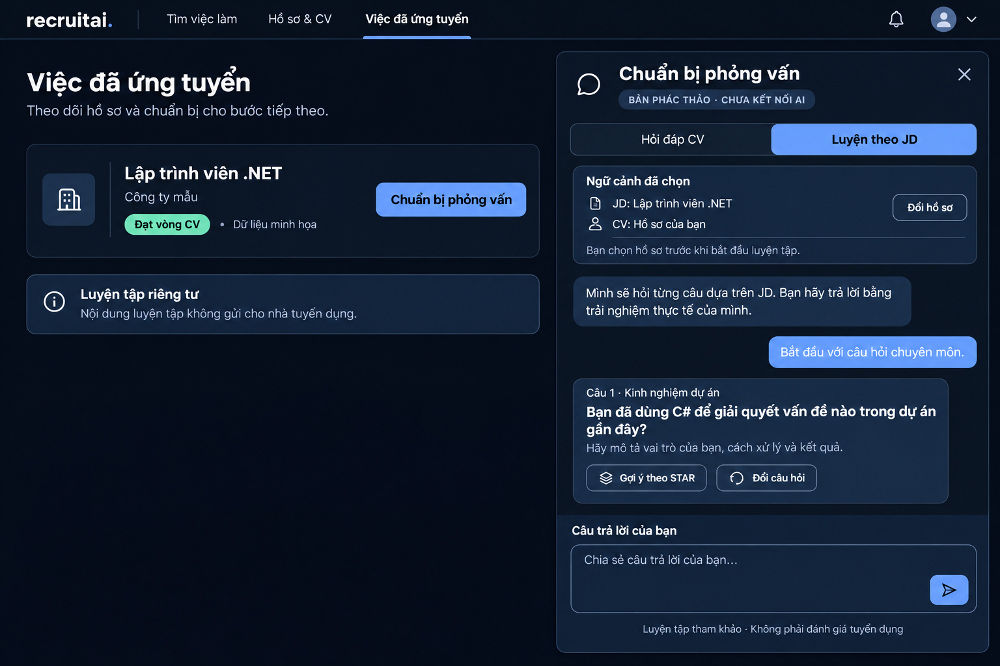

# Chatbox: rà soát nhánh anhkhang và phương án cho ứng viên

Ngày xem: 13/11/2026. Nhánh thực tế là [`anhkhang`](https://github.com/bathach56/AI-Recruitment/tree/anhkhang), không phải `anhkhanh`. Chỉ đọc nhánh và chạy kiểm tra FAQ trong thư mục tạm, không checkout, merge hoặc thay dữ liệu web hiện tại.

## Thành viên đã làm tới đâu?

| Phần | Bằng chứng trong mã | Đánh giá |
|---|---|---|
| Widget Hỗ trợ CV | `webAI/wwwroot/js/chat.js`, `css/chat.css`, `_Layout.cshtml` | Có mở/đóng, Enter/Shift+Enter, Esc, câu hỏi gợi ý, trạng thái đang nhập và bố cục nhỏ |
| FAQ tiếng Việt | Chuẩn hóa bỏ dấu, regex nhận ý định, trả lời định sẵn | Đã có chức năng; không phải hội thoại sinh bằng LLM |
| Tóm tắt CV | Hàm `summarizeCv`, nhận các tiêu đề mục, giữ tối đa hai trích đoạn mỗi mục | Trích xuất theo quy tắc, không phải phân tích ngữ nghĩa hoặc kiểm chứng năng lực |
| Lịch sử | Tối đa 16 câu hỏi trong localStorage; lệnh tóm tắt và kết quả tóm tắt không ghi lịch sử | Có xử lý storage lỗi; câu hỏi thường vẫn có thể chứa thông tin người dùng tự nhập |
| API mô hình | `ChatController`, `RecruitmentChatService` gọi Ollama localhost `/api/chat` | Có mã backend, cấu hình model, giới hạn tin/kích thước và xử lý lỗi; giao diện FAQ hiện không gọi API này |
| Kiểm tra | `chat-rules.test.cjs`, API/provider fixtures và browser tests | Đã chạy lại 5/5 kiểm tra quy tắc đạt. Chưa chạy API với Ollama thật hoặc các browser tests trong lần rà soát này |

Nguồn: [tài liệu nhánh](https://github.com/bathach56/AI-Recruitment/blob/anhkhang/docs/CHATBOX.md), [giao diện/quy tắc](https://github.com/bathach56/AI-Recruitment/blob/anhkhang/webAI/wwwroot/js/chat.js), [controller](https://github.com/bathach56/AI-Recruitment/blob/anhkhang/webAI/Controllers/ChatController.cs), [dịch vụ mô hình](https://github.com/bathach56/AI-Recruitment/blob/anhkhang/webAI/Services/RecruitmentChatService.cs).

## Có nên thêm?

Nên thêm có giới hạn, dưới dạng **hỗ trợ ứng viên và chuẩn bị phỏng vấn**, sau hoặc song song phần lõi xét CV; không gọi đây là mô hình xét tuyển mới. Không merge toàn nhánh: `Program.cs` trên nhánh đó chưa có cơ chế tài khoản/SQL hiện tại, các trang cũng thuộc giao diện trước đó.

Trước khi dùng lại cần:

1. Sửa FAQ và system prompt cũ: hiện còn nói chưa nộp CV, chưa có tài khoản/lịch sử và kết quả chỉ giữ trong trang. Luồng thực tế hiện đã có SQL, hồ sơ ứng tuyển và trang kết quả riêng.
2. Giữ FAQ xử lý tại chỗ, ghi rõ là Hướng dẫn nhanh. Không làm người dùng nhầm câu trả lời quy tắc với suy luận LLM.
3. Nếu thêm luyện phỏng vấn theo CV/JD, backend phải lấy đúng hồ sơ của Candidate đăng nhập, kiểm tra ApplicationId; không tin CV/JD ID do trình duyệt gửi để đọc dữ liệu bất kỳ.
4. Thêm CSRF, giới hạn theo người dùng, timeout/hủy yêu cầu và thông báo model chưa sẵn sàng theo cấu trúc ứng dụng hiện tại. API localhost-only của nhánh chưa đủ cho truy cập từ máy khác.
5. Không tự lưu CV hoặc hội thoại nhạy cảm trong localStorage chung giữa tài khoản. Phiên luyện riêng, có thao tác xóa; không gửi nội dung luyện tập cho nhà tuyển dụng.
6. Ollama/model hội thoại là thành phần riêng với Sentence-BERT đối chiếu. Cần chốt model, khả năng chạy trên máy demo và đánh giá câu trả lời trước khi bật thật. Không có mô hình thì hiện chưa sẵn sàng; không giả vờ có phản hồi AI.

## Trang tuyển dụng khác có dùng không?

- [LinkedIn AI interview prep](https://www.linkedin.com/help/learning/answer/a9308146): luyện phỏng vấn theo JD, hỗ trợ trả lời giọng nói/văn bản và nhận phản hồi. Tài liệu có nêu giới hạn tài khoản/ngôn ngữ/triển khai; không giả định mọi người đều dùng được.
- [Indeed Career Scout](https://www.indeed.com/careerscout): trợ lý dạng hội thoại cho tìm việc, CV và luyện phỏng vấn. Đây là trợ lý nghề nghiệp, khác với hộp nhắn tin giữa nhà tuyển dụng và ứng viên.
- Không có đủ bằng chứng trong lần xem này để khẳng định TopCV có chatbot luyện phỏng vấn tương đương. Không lấy chatbot chăm sóc khách hàng làm bằng chứng cho tính năng luyện phỏng vấn.

Các mô hình thương mại chỉ là tham khảo cách tổ chức chức năng, không chứng minh hiệu quả của mô hình đồ án.

## Bản phác thảo đề xuất

- Điểm vào 1: nút **Chuẩn bị phỏng vấn** trong popup kết quả ứng tuyển khi người tuyển dụng đã cho qua vòng CV. Cách gọi “Đạt vòng CV” là đề xuất giao diện, chưa thay trạng thái hiện tại.
- Điểm vào 2: nút **Trợ lý CV** dành cho Candidate để hỏi cách dùng web, viết CV; phần luyện theo vị trí yêu cầu chọn đúng hồ sơ.
- Panel bên phải trên máy tính; màn hình riêng toàn chiều ngang trên điện thoại. Tiêu đề **Chuẩn bị phỏng vấn**, hai chế độ **Hỏi đáp CV** / **Luyện theo JD**.
- Hiện CV/JD nào được dùng, cho người dùng chủ động chọn trước khi gửi ngữ cảnh. Không mở toàn bộ hồ sơ tài khoản cho bot.
- Luyện một câu mỗi lượt, sau khi người dùng trả lời mới gợi ý cấu trúc STAR và điểm cần bổ sung. Không viết thay kinh nghiệm, không bịa thành tích, không chấm xác suất trúng tuyển.
- Nhắc rõ: không phải nhà tuyển dụng, câu hỏi chỉ phục vụ luyện tập; không dự đoán câu hỏi thật hoặc sửa kết quả xét CV.

Ảnh phác thảo là dữ liệu minh họa, chưa kết nối mô hình và chưa đưa vào web chính. Chốt thiết kế và phạm vi trước, sau đó mới chọn lọc mã FAQ/widget phù hợp từ nhánh thành viên.

